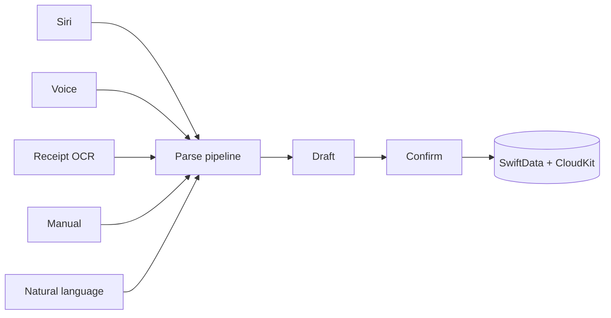
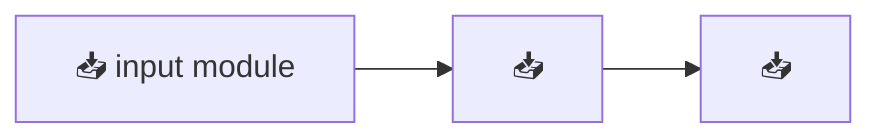

# Noor Akhnafal Aban

**Software Engineer — iOS & Backend · Jakarta, Indonesia**

> PPT-scroll portfolio · written for HR & Technical Leads · 3–5 min read · last updated 2026-10-26
> One linear story: **two iOS projects, in depth, one by one** — not many projects, shallow.

<details>
<summary>📋 Cara mengisi canvas ini (untuk kamu, hilangkan nanti)</summary>

- `📥 INPUT` — slot menunggu isian kamu. Ganti teksnya, hapus markernya.
- `✅` — fakta terverifikasi (dari repo GitHub & situs lama). Boleh dipertahankan.
- Setiap garis `---` = batas satu slide (PPT-scroll, scroll vertikal).
- Screenshot & video: simpan di folder `media/<project>/`, path sudah ditentukan di tabel.

Konten publik pakai Bahasa Inggris. Kalau mau semua Bahasa Indonesia, bilang saja.
</details>

---

## Hi — I'm Noor. I build things that run.

- **iOS** — SwiftUI, SwiftData, CloudKit, Foundation Models, Vision. Currently Junior iOS Developer at **Apple Developer Academy @ UC Jakarta**.
- **Backend** — Laravel, MySQL, Redis, Linux. One production gym-management platform (Really Sport Center) running on my own servers, maintained over SSH.
- **Research** — published topic-modeling paper, *Rabit: Jurnal Teknologi & Sistem Informasi* 11(1), 2026. GEMASTIK 2025 national round, top 6.
- **This page** — 2 deep-dive case studies, 3–5 minutes. Scroll.

---

## A resume lists. This tells the story of two apps, end to end.

1. **AkhnaFin** — personal finance capture: five input paths into one pipeline. Flagship, solo. ✅
2. **BreathingApp** — breathing & movement iOS app, Apple Developer Academy Challenge 1. Team-built. ✅

Each case study follows the same arc: **Problem → Tech Stack → Architecture → Core Code → UI → Hardest Challenges → Results → Lessons.**

---

# Case Study 1 · AkhnaFin

| | |
|---|---|
| **Repo** | [akhnafal-aban/AkhnaFin](https://github.com/akhnafal-aban/AkhnaFin) (public) ✅ |
| **Platform** | iOS (iPhone) |
| **Year** | 2026 |
| **Role** | Solo developer ✅ |
| **Tagline** | Personal finance capture — five input paths (Siri, natural language, voice, receipt OCR, manual) funnel into one **parse → draft → confirm** pipeline. ✅ |

## Problem

> 📥 INPUT — 2–3 kalimat. Jawab:
> - Siapa user-nya dan apa yang bikin frustrasi di app keuangan yang ada?
> - Kenapa harus lima jalur input, bukan satu?
> - Apa momen "kenapa app ini harus ada"?

## Tech Stack

- Swift · SwiftUI ✅
- SwiftData (persistence) · CloudKit (sync) ✅
- Foundation Models (on-device parsing) ✅
- Vision (receipt OCR) ✅
- 📥 INPUT — ada lagi? (WidgetKit, Charts, App Intents…)

## Architecture



> ✅ dibuat dari deskripsi repo. 📥 INPUT — refine jadi modul Swift aslinya (nama file/actor/key type).

## Core Code

```swift
// 📥 INPUT — paste 10–20 baris paling mewakili. Pilihan bagus:
// 1) state machine parse → draft → confirm, atau
// 2) prompt struct yang dikirim ke Foundation Models,
// 3) konfigurasi CloudKit sync.
// Technical Lead baca ini untuk menilai cara kamu berpikir, bukan volumenya.
```

## UI — 3–4 screenshots asli

| # | Screenshot | Caption | File |
|---|---|---|---|
| 1 | 📥 | Halaman capture — 5 jalur input | `media/akhnafin/ui-1.png` |
| 2 | 📥 | Hasil parse → draft | `media/akhnafin/ui-2.png` |
| 3 | 📥 | Konfirmasi / edit | `media/akhnafin/ui-3.png` |
| 4 | 📥 | Insight atau home | `media/akhnafin/ui-4.png` |

## Hardest Challenges — 1–2

### Challenge 1 · 📥 INPUT (judul)

> **Masalah:** 📥
> **Solusi:** 📥
>
> *(Saran yang sering terjadi, pakai kalau benar: akurasi parse input natural-language yang berantakan — format rupiah, nama merchant, hasil ASR — bagaimana kamu menormalkannya?)*

### Challenge 2 · 📥 INPUT (judul)

> **Masalah:** 📥
> **Solusi:** 📥
>
> *(Saran: konsistensi data offline-first dengan CloudKit — konflik sinkronisasi. Kalau tidak terjadi, tulis apa yang benar-benar tersulit.)*

## Results

| Metrik | Angka |
|---|---|
| 📥 INPUT | 📥 |

> 📥 INPUT — sudah dipakai berapa user? akurasi parse? crash-free rate? review TestFlight? Tidak harus angka besar; jujur lebih kuat.

## Lessons

- 📥 INPUT — 2–3 baris.
- 📥 INPUT

---

# Case Study 2 · BreathingApp

| | |
|---|---|
| **Repo** | [akhnafal-aban/BreathingApp](https://github.com/akhnafal-aban/BreathingApp) (public) ✅ |
| **Platform** | iOS |
| **Year** | 2026 |
| **Role** | Team (Apple Developer Academy Challenge 1) ✅ |
| **Tagline** | Breathing & movement app — Apple Developer Academy Challenge 1. ✅ |

## Problem

> 📥 INPUT — apa masalah kesehatan/wellness yang app ini jawab? kenapa bentuknya breathing + movement?

## Tech Stack

> 📥 INPUT — SwiftUI? HealthKit? RealityKit? CoreAnimation?

## Architecture



> 📥 INPUT — gambar alur data aslinya.

## Core Code

```swift
// 📥 INPUT — 10–20 baris: animasi napas, sinkronisasi HealthKit, atau scheduler sesi.
```

## UI — 3–4 screenshots asli

| # | Screenshot | Caption | File |
|---|---|---|---|
| 1 | 📥 | 📥 | `media/breathing-app/ui-1.png` |
| 2 | 📥 | 📥 | `media/breathing-app/ui-2.png` |
| 3 | 📥 | 📥 | `media/breathing-app/ui-3.png` |
| 4 | 📥 | 📥 | `media/breathing-app/ui-4.png` |

## Hardest Challenge — 1

> **Masalah:** 📥
> **Solusi:** 📥

## Results

> 📥 INPUT

## Lessons

- 📥 INPUT

---

## Supporting Evidence — canvas (prioritas)

> 📥 Setiap proyek butuh 3 bukti di bawah. Slot path sudah disiapkan — tinggal isi.

### AkhnaFin

| Bukti | Status | Slot |
|---|---|---|
| Demo video 15–30 detik, loop dalam frame device (rekaman simulator OK) | ⏳ belum diisi | `media/akhnafin/demo.mp4` |
| Link TestFlight (jika app bisa diinstall) | ⏳ belum diisi | paste URL — |
| Link GitHub (jika repo aman dipublikasikan) | ✅ sudah public | github.com/akhnafal-aban/AkhnaFin |

### BreathingApp

| Bukti | Status | Slot |
|---|---|---|
| Demo video 15–30 detik, loop dalam frame device (rekaman simulator OK) | ⏳ belum diisi | `media/breathing-app/demo.mp4` |
| Link TestFlight (jika app bisa diinstall) | ⏳ belum diisi | paste URL — |
| Link GitHub (jika repo aman dipublikasikan) | ✅ sudah public | github.com/akhnafal-aban/BreathingApp |

---

## Domain Strategy — satu domain, dedikasi terasa personal

**Domain utama:** `portofolio-aban.my.id` 📥 INPUT (klaim & verifikasi)

Setiap perusahaan dapat entry point sendiri — subdomain atau path:

| Perusahaan | URL | Varian |
|---|---|---|
| JavaMifi | `javamifi.portofolio-aban.my.id` | framing + case study dipilih khusus JavaMifi |
| 📥 INPUT | `📥.portofolio-aban.my.id` | — |

**Kenapa begini:**
- **Satu domain, banyak wajah** — tiap subdomain = varian PPT-scroll yang sama, tapi pembuka & case study dikurasi untuk perusahaan itu ("dibuat khusus untuk kalian", terasa personal).
- **Biaya nol tambahan** — cukup satu domain + wildcard SSL (`*.portofolio-aban.my.id`), tidak beli domain per perusahaan.
- **Trackable** — analytics per subdomain/path: tahu persis siapa membuka yang mana.
- Alternatif path: `portofolio-aban.my.id/javamifi` kalau DNS subdomain tidak memungkinkan.

---

## Contact

- email / akhnafal03@gmail.com ✅
- github / [akhnafal-aban](https://github.com/akhnafal-aban) ✅
- linkedin / [akhnaf-aban](https://www.linkedin.com/in/akhnaf-aban) ✅

© 2026 Noor Akhnafal Aban · Jakarta, Indonesia