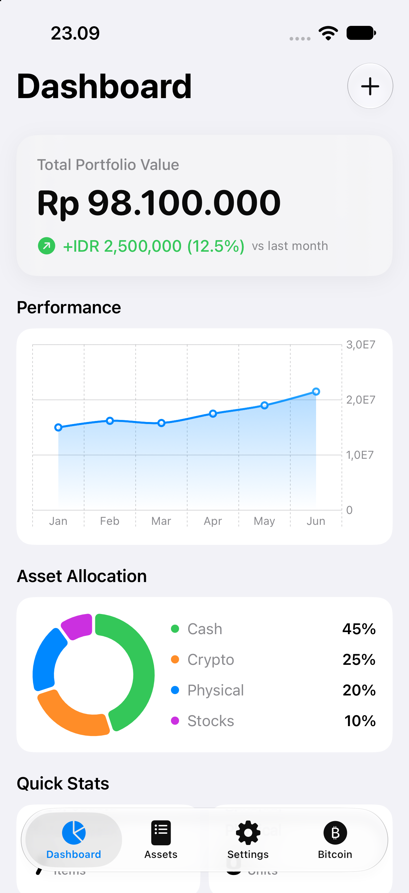
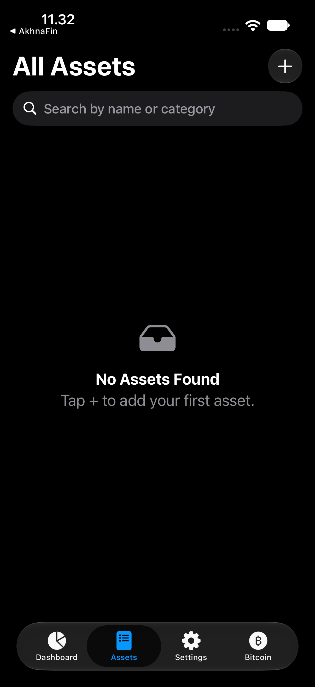
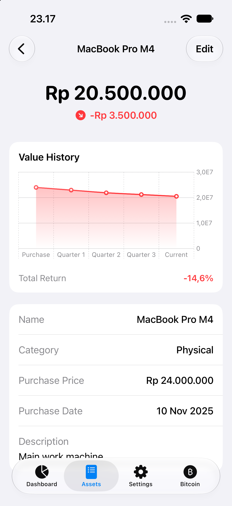
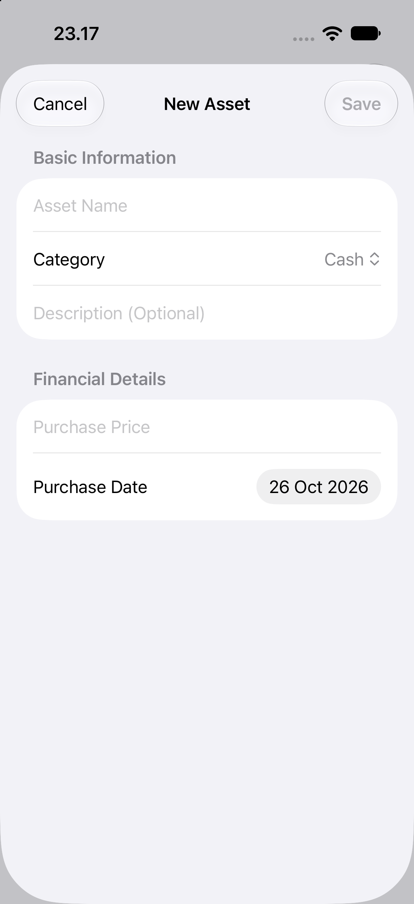
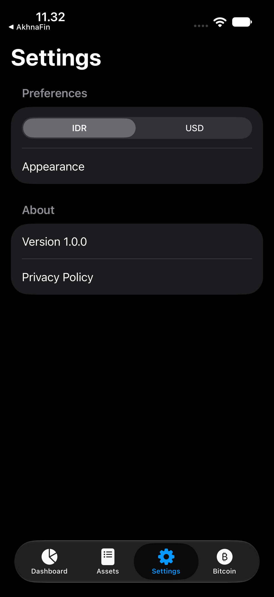
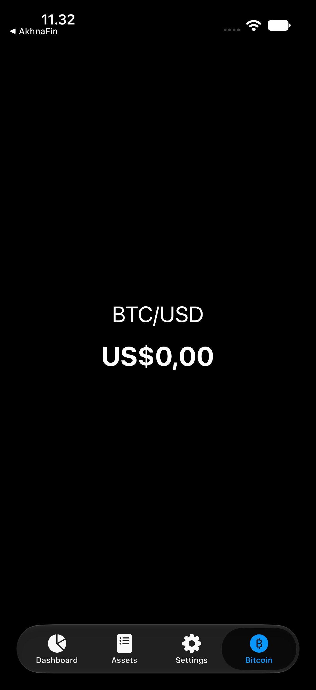

# Asset Tracker — Case Study

Ringkasan: Aplikasi iOS pelacak aset pribadi (uang tunai, barang fisik, saham, dan kripto) yang dibangun dengan SwiftUI dan mengambil data dari REST API buatan sendiri berbahasa Go. Proyek pembelajaran intensif untuk memahami konsumsi API dari sisi klien iOS.
Peran: Saya mengerjakan seluruh aplikasi iOS — arsitektur, networking, UI, dan integrasi dengan backend.
Status: Prototype
Tech Stack: SwiftUI, Foundation (URLSession + Codable), Swift Charts, Observation

## 1. Masalah

Saya datang dari pengembangan backend: saya terbiasa berada di sisi yang *membuat* API. Ketika pindah ke iOS, ada gap yang saya rasakan sendiri — saya belum paham bagaimana API sebetulnya dikonsumsi dari sisi klien.

Kenyataan di lapangan: hampir semua aplikasi bisnis menyimpan datanya di server, dan satu-satunya jembatan antara server itu dengan aplikasi iOS adalah API. Seorang developer iOS yang tidak nyaman mengambil, mengirim, dan menangani data lewat REST API terputus dari separuh aplikasi yang dia kerjakan.

Asset Tracker adalah jawaban atas gap itu. Aplikasinya sendiri sederhana — catat aset, lihat nilai total, lihat grafik — tapi tujuannya bukan fiturnya. Tujuannya adalah menjalani sendiri seluruh jalur: backend Go yang saya tulis, dijalankan di mesin lokal, dikonsumsi lewat `URLSession` oleh SwiftUI, dan ditampilkan sebagai UI yang benar. Satu loop penuh, dari database sampai layar.

## 2. Tech Stack

- **SwiftUI**: UI deklaratif dengan state yang terikat langsung ke data. Untuk proyek belajar, SwiftUI membuat iterasi cepat — ubah state, UI mengikuti.
- **Foundation (`URLSession` + `Codable`)**: inti dari proyek ini. Saya sengaja tidak memakai library networking pihak ketiga, supaya paham apa yang sebenarnya terjadi di balik sebuah fetch.
- **Swift Charts**: grafik line dan donut di dashboard. Framework bawaan Apple, satu dependency yang ringan.
- **Observation (`@Observable`)**: state management view model tanpa boilerplate `ObservableObject`/`@Published`.

## 3. Arsitektur

Pola yang saya pakai adalah MVVM — Model, View, ViewModel. Saya menemukan pola ini dari kajian arsitektur iOS dan kurikulum Hacking with Swift (Paul Hudson). Catatan penting: Hudson mengajarkan MVVM sebagai salah satu pola — bukan satu-satunya — dan mengingatkan keterbatasannya dengan SwiftData. Karena Asset Tracker tidak memakai SwiftData (datanya datang dari API), kekhawatiran itu tidak berlaku di sini, dan pemisahan MVVM membantu saya menjaga logika fetch di luar file view.

Setiap screen memiliki pasangan View + ViewModel, dan data berpindah lewat satu lapisan `Api` di folder `Core/Network`:

```sh
Asset Tracker/
├── App/
│   ├── AppConfig.swift        # baseURL + environment (local)
│   └── AssetTrackerApp.swift  # entry point app
├── Core/
│   ├── Model/                 # struct model: Asset, AssetCategory, User, TradePrice, AppSettings
│   ├── Network/
│   │   └── Api.swift          # wrapper URLSession — inti networking
│   └── Services/
│       └── BinanceWebSocketService.swift  # harga Bitcoin realtime
└── Screens/
    ├── Root/
    │   └── AppRootView.swift  # TabView — 4 tab utama
    ├── Main/
    │   ├── Dashboard/         # DashboardView + ViewModel
    │   ├── Assets/            # AssetView, AssetDetailView + ViewModel
    │   ├── Crypto/            # CryptoDashboardView + ViewModel
    │   ├── Settings/          # SettingsView
    │   └── Toolbar/           # AddAssetView + ViewModel (sheet tambah aset)
    └── Components/            # AssetRowView, StatCardView — komponen reusable
```

Penjelasan per folder:

- **`App/`** — konfigurasi global dan entry point. `AppConfig.swift` menyimpan baseURL di satu tempat, jadi kalau server pindah, cukup ubah satu file.
- **`Core/`** — lapisan yang tidak kenal UI. `Model/` berisi struct hasil decode JSON; `Network/Api.swift` satu-satunya pintu keluar-masuk HTTP; `Services/` untuk koneksi lain (WebSocket). Prinsipnya: kalau suatu saat UI diganti, `Core/` tidak ikut diubah.
- **`Screens/`** — semua UI. `Root/` memutuskan navigasi level atas (TabView), `Main/` berisi screen per fitur, `Components/` berisi view kecil yang dipakai ulang di beberapa tempat.

Aliran data: View memanggil ViewModel lewat `.task { }` → ViewModel memanggil `Api.send(...)` → `Api` memanggil `URLSession` → data didecode menjadi model → ViewModel memperbarui property `@Observable` → SwiftUI ikut memperbarui UI secara reaktif.

## 4. Code Utama

File paling representatif untuk proyek ini adalah `Core/Network/Api.swift` — seluruh lapisan networking yang saya tulis manual, tanpa library. Berikut penjelasan per blok.

**`HTTPMethod` — enum method HTTP**

```swift
enum HTTPMethod: String {
    case get = "GET"
    case post = "POST"
    case put = "PUT"
    case patch = "PATCH"
    case delete = "DELETE"
}
```

Kenapa perlu: string `"GET"` yang mengetik sembarangan di banyak tempat cepat jadi sumber bug salah ketik. Enum membatasi nilai yang sah ke lima method yang tersedia, lengkap dengan autocomplete.

**`Api.request(...)` — satu titik untuk semua HTTP**

```swift
struct Api {
    static func request(endpoint: String, method: HTTPMethod, body: Data? = nil) async throws -> Data {
        var request = URLRequest(url: URL(string: "\(AppConfig.baseURL)\(endpoint)")!)
        request.httpMethod = method.rawValue
        request.setValue("application/json", forHTTPHeaderField: "Content-Type")
        request.httpBody = body

        let (data, _) = try await URLSession.shared.data(for: request)
        return data
    }
}
```

Keputusan desainnya sederhana tapi berpengaruh: semua request lewat fungsi ini, jadi header `Content-Type`, baseURL, dan method selalu seragam. `URLSession.shared.data(for:)` versi `async/await` membuat kode fetch tanpa closure bersarang — error mengalir lewat `throws`, menunggu lewat `await`.

**`send(...)` untuk GET — decode ke tipe generik**

```swift
static func send<T: Decodable>(
    endpoint: String,
    method: HTTPMethod = .get,
    type: T.Type
) async throws -> T {
    let data = try await request(endpoint: endpoint, method: method)

    let decoder = JSONDecoder()
    decoder.keyDecodingStrategy = .convertFromSnakeCase
    decoder.dateDecodingStrategy = .iso8601

    return try decoder.decode(T.self, from: data)
}
```

Dua baris strategi decode ini menyelamatkan banyak mapping manual. Backend Go saya menulis field pakai `snake_case` (`current_value`), sedangkan Swift konvensinya `camelCase` (`currentValue`). `convertFromSnakeCase` mengubah JSON `current_value` menjadi property `currentValue` secara otomatis — tidak perlu `CodingKeys` dari tangan. `iso8601` menangani tanggal dengan cara yang sama.

**`send(...)` dengan body — encode object menjadi JSON**

```swift
static func send<T: Decodable, U: Encodable>(
    endpoint: String,
    method: HTTPMethod = .get,
    body: U? = nil,
    type: T.Type
) async throws -> T {
    let encodedBody: Data?
    if let body {
        let encoder = JSONEncoder()
        encoder.keyEncodingStrategy = .convertToSnakeCase
        encoder.dateEncodingStrategy = .iso8601
        encodedBody = try encoder.encode(body)
    } else {
        encodedBody = nil
    }

    let data = try await request(endpoint: endpoint, method: method, body: encodedBody)
    // decode dan return, sama seperti versi GET
}
```

Overload ini untuk request yang membawa data (POST/PUT). Arahnya kebalikan dari versi GET: struct Swift di-encode dengan `convertToSnakeCase`, supaya server Go menerima field dengan konvensi nama yang dia harapkan. Karena `keyEncodingStrategy` dan `keyDecodingStrategy` simetris, satu konvensi nama dipertahankan bolak-balik tanpa saya memikirkan per field.

**Kejujuran teknis** — tiga hal di file ini yang masih saya kenali sebagai kekurangan dan jadi bahan pelajaran (dibahas di bagian Pelajaran): URL di-force-unwrap, status HTTP tidak pernah dicek, dan error hanya di-`print`.

## 5. UI Utama

Beberapa screenshot asli aplikasi, diambil dari simulator dengan backend Go lokal yang sedang berjalan.

| Screenshot | Aset | Keterangan |
|---|---|---|
| UI 1 — Dashboard |  | Nilai portofolio dihitung live dari data API, grafik performance, alokasi aset, dan quick stats |
| UI 2 — Assets |  | Daftar semua aset dari endpoint `GET /assets`, dengan search |
| UI 3 — Detail Aset |  | Detail satu aset setelah memilih dari daftar |
| UI 4 — Tambah Aset |  | Form tambah aset — data dikirim lewat `POST /assets` |
| UI 5 — Settings |  | Halaman pengaturan |
| UI 6 — Bitcoin |  | Tab harga Bitcoin via WebSocket — saat screenshot, feed belum mengirim tick pertama (state awal prototipe) |

### Stack dan List

Semua layout di Asset Tracker dibangun dari kotak-kotak dasar yang sama. Berikut rangkuman pola yang paling banyak dipakai, dengan kode dari project ini.

**`VStack` — susunan vertikal.** Kontainer paling dasar; hampir semua screen dimulai darinya.

```swift
VStack(alignment: .leading, spacing: 8) {
    Text("Total Portfolio Value")
        .font(.subheadline)
        .foregroundStyle(.secondary)
    Text(viewModel.totalValue, format: .currency(code: appSettings.selectedCurrency))
        .font(.system(.largeTitle, design: .rounded))
        .fontWeight(.bold)
}
```

`spacing` mengatur jarak antar anak, `alignment` meratakan ke kiri.

**`HStack` — susunan horizontal.** Dipakai untuk baris ikon + teks, atau header dengan `Spacer()` yang mendorong elemen ke tepi berlawanan:

```swift
HStack {
    Text("Recent Assets").font(.headline)
    Spacer()
    NavigationLink("View All", destination: AssetView())
        .foregroundStyle(Color.accentColor)
}
```

**`HStack` + `Spacer()` untuk baris data** — pola baris daftar seperti `AssetRowView`:

```swift
HStack(spacing: 12) {
    Circle() // ikon kategori
    VStack(alignment: .leading, spacing: 4) {
        Text(asset.name)
        Text(categoryName ?? "Unknown")
    }
    Spacer()  // mendorong blok kanan ke ujung kanan
    VStack(alignment: .trailing, spacing: 4) {
        Text(asset.currentValue, format: .currency(code: appSettings.selectedCurrency))
        // perubahan nilai (hijau jika untung, merah jika rugi)
    }
}
```

**`List` untuk data yang diulang** — dari `AssetView`:

```swift
List(filteredAssets) { asset in
    NavigationLink(value: asset) {
        AssetRowView(asset: asset, categoryName: asset.category?.name)
    }
}
.listStyle(.insetGrouped)
.searchable(text: $searchText, prompt: "Search by name or category")
```

**`LazyVGrid` untuk kartu statistik 2 kolom** — dari dashboard:

```swift
LazyVGrid(columns: [GridItem(.flexible()), GridItem(.flexible())], spacing: 16) {
    StatCardView(tittle: "Total Assets", value: viewModel.assetsCount, unit: "Items")
    StatCardView(tittle: "Physical", value: "3", unit: "Units")
    StatCardView(tittle: "Liquid Cash", value: "2", unit: "Accounts")
    StatCardView(tittle: "Investments", value: "1", unit: "Portfolio")
}
```

**`Form` untuk input** — dari `AddAssetView`:

```swift
Form {
    Section("Basic Information") {
        TextField("Asset Name", text: $name)
        Picker("Category", selection: $selectedCategoryId) { /* ... */ }
        TextField("Description (Optional)", text: $description)
    }
    Section("Financial Details") {
        TextField("Purchase Price", value: $purchasePrice, format: .currency(code: "IDR"))
        DatePicker("Purchase Date", selection: $purchaseDate, displayedComponents: .date)
    }
}
```

Formula mental yang saya pakai: vertikal pakai `VStack`, horizontal pakai `HStack`, data berulang pakai `List` (atau `LazyVGrid` untuk grid), input pengguna pakai `Form`. `ZStack` (lapisan bertumpuk) belum banyak dibutuhkan di aplikasi ini — kejujuran desain: jangan memakai container yang tidak dibutuhkan.

## 6. Tantangan Teknis dan Solusi

<!-- CATATAN: bagian ini adalah REKOMENDASI narasi dari sisi kode yang terverifikasi.
     Baca, sesuaikan dengan yang benar-benar kamu alami, lalu hapus catatan ini. -->

Tantangan 1: Konvensi nama dari dua bahasa yang berbeda

- Masalah: backend Go menulis JSON dalam `snake_case` (`current_value`), sementara Swift memakai `camelCase` (`currentValue`). Tanpa penanganan, decode gagal atau property kosong.
- Analisis: output JSON dari `GET /assets` dicek langsung (misal lewat `curl`), lalu dibandingkan dengan struct Swift di `Core/Model/Asset.swift`.
- Solusi: dua pengaturan simetris di `JSONEncoder`/`JSONDecoder` — `keyDecodingStrategy = .convertFromSnakeCase` saat membaca, `keyEncodingStrategy = .convertToSnakeCase` saat mengirim. Mapping nama ditangani satu kali di `Api.swift`, bukan per struct.
- Hasil: komunikasi bolak-balik API berjalan tanpa satu pun `CodingKeys` manual.

## 7. Hasil

Yang terverifikasi dari alur lengkap yang berjalan:

- Aplikasi iOS berhasil mengonsumsi `GET /assets` — total nilai portofolio di dashboard dihitung dari data API, daftar aset di tab Assets terisi, dan form `POST /assets` mengirim data ke server.
- Layering `handler → service → repository` di sisi backend dengan rapi, dan lapisan `Api` tipis di sisi iOS sebagai satu pintu networking.
- Tab Bitcoin masih menampilkan nilai default (belum ada tick masuk) — feed WebSocket belum terselesaikan, ini status jujur dari prototipe.

<!-- PLACEHOLDER: metrik tambahan bila ada — jumlah aset yang pernah di-CRUD, dll. Jangan klaim yang belum teruji. -->

## 8. Pelajaran

- **Kedua sisi satu protokol.** Setelah menulis REST API di Go dan mengonsumsinya di Swift, saya memahami mengapa kontrak JSON (nama field, format tanggal, status code) harus disepakati dulu: backend dan klien saling menulis berdasarkan asumsi yang sama.
- **Jangan memakai library sebelum paham masalahnya.** `URLSession` + `Codable` manual menunjukkan apa yang sebenarnya dipermudah oleh library seperti Alamofire — sekarang saya bisa menilai library dengan dasar, bukan kebiasaan.
- **Kekurangan yang kukenali di `Api.swift` untuk diperbaiki berikutnya:** URL masih di-force-unwrap (baseURL `nil` akan crash), status HTTP tidak dicek (response 500 dan 200 diperlakukan sama), dan error hanya di-`print` — pengguna tidak pernah tahu apa yang salah. Perbaikan yang direncanakan: cek status code, mapping error menjadi pesan UI, dan layar error state.
- **MVVM membantu di proyek yang datanya dari jaringan.** Menjauhkan fetch dari view membuat `#Preview` dan iterasi UI jadi lebih cepat; tapi ini satu pola dari banyak pola — keputusan arsitektur ditentukan kebutuhan proyeknya, bukan dogma.

## Bukti Pendukung

- Video demo 15–30 detik: [PLACEHOLDER — tautan video]
- TestFlight: https://testflight.apple.com/join/w9My8GDY
- GitHub: https://github.com/akhnafal-aban/Asset-Tracker (klien iOS) · https://github.com/akhnafal-aban/asset-tracker-be (backend Go)
- Screenshot UI: 6 screenshot asli terlampir di bagian UI Utama